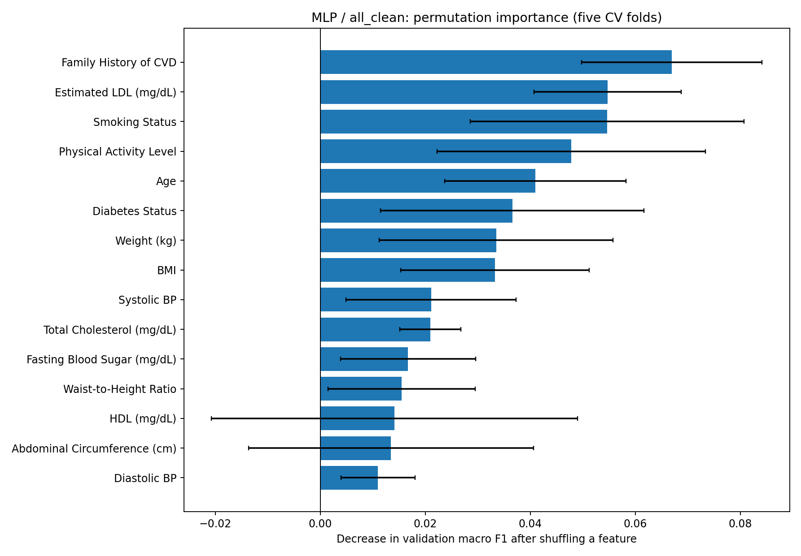

# CVD Risk Level Classification — reproducible tabular ML study

A research-oriented refactoring of university coursework into a Python/scikit-learn project: exploratory analysis, data quality audit, **multiclass classification**, stratified cross-validation, preprocessing ablations, error analysis and model interpretation.

> **Educational research only. Not a clinically validated risk score, disease predictor or medical device.** The provenance and clinical validity of the target labels have not been established.

## Key results

The primary metric is **macro F1**, which gives equal weight to the three unequally represented classes (`HIGH`, `INTERMEDIARY`, `LOW`). All cross-validation results below come from the **same five stratified folds of the training subset** (80% of 1,529 rows, seed 42). Preprocessing statistics are fitted separately within each fold.

| Model / feature set | Mean CV macro F1 | SD across folds | Mean CV balanced accuracy |
|---|---:|---:|---:|
| Dummy, `all_clean` | 0.215 | 0.001 | 0.333 |
| Logistic regression, `all` | 0.521 | 0.044 | 0.521 |
| Logistic regression, `all_clean` | 0.519 | 0.035 | 0.526 |
| MLP, `all` | 0.473 | 0.025 | 0.474 |
| **MLP, `all_clean`** | **0.552** | **0.022** | **0.552** |

Using `all_clean` instead of `all` raised MLP's mean CV macro F1 by **0.080** across these five folds. The per-class out-of-fold F1 for the minority class `LOW` increased from **0.187 to 0.319**. This is an improvement in reproducing the provided **risk labels**, *not* evidence of clinical utility. Results are descriptive, not proof of population-wide generalization.

### What changed in preprocessing?

The strongest effect came from **dropping the high-cardinality string representation of blood pressure** (1,254 unique values) while retaining its numerical counterparts. This single change increased MLP's mean CV macro F1 from **0.473 to 0.536**. The full deterministic `all_clean` transformation reached **0.552**. The ablation varies one change at a time and in leave-one-step-out combinations; effects are not necessarily additive.

| Configuration | MLP mean CV macro F1 |
|---|---:|
| Original `all` | 0.473 |
| Drop string BP only | 0.536 |
| Recover numeric BP, drop string BP | 0.538 |
| `all_clean` without height processing | 0.525 |
| `all_clean` without LDL processing | 0.548 |
| Full `all_clean` | **0.552** |

See [results/preprocessing_ablation_summary.csv](results/preprocessing_ablation_summary.csv) and [docs/experiments.md](docs/experiments.md).

### Interpreting the MLP

Five-fold validation **permutation importance** (average drop in macro F1 after shuffling one original input column):

| Feature | Mean macro-F1 drop |
|---|---:|
| Family History of CVD | 0.0669 |
| Estimated LDL (mg/dL) | 0.0547 |
| Smoking Status | 0.0546 |
| Physical Activity Level | 0.0478 |
| Age | 0.0410 |
| Diabetes Status | 0.0366 |

Results are model-specific dependencies, **not causal effects** or medically validated feature weights. Correlated predictors can substitute for one another. Full data: [results/mlp_permutation_importance_cv_summary.csv](results/mlp_permutation_importance_cv_summary.csv).



## Dataset and limitations

Source: [Cardiovascular Disease Risk Assessment Dataset (Kaggle)](https://www.kaggle.com/datasets/ahmeduzaki/cardiovascular-disease-risk-assessment-dataset). The dataset has **1,529 rows, 22 columns**, no exact duplicate records, and missing values in multiple numeric fields. Class counts: HIGH 728, INTERMEDIARY 581, LOW 220.

The audit revealed several issues:

- `CVD Risk Score` is approximately deterministic given other measured columns (max discrepancy **0.0004** among 1,146 complete cases). It is **excluded** from the feature matrix.
- `CVD Risk Level` strongly overlaps across numerical `CVD Risk Score` ranges, so it is *not* a simple threshold mapping of the score. Its labeling process and clinical validity are **unknown**.
- BMI disagrees with weight / height² by more than 0.5 in **449/1,328 complete cases**. These rows were not automatically removed or overwritten.
- There are **13 negative** `Estimated LDL (mg/dL)` entries.
- The text `Blood Pressure (mmHg)` column has **1,254 unique strings** and overlaps with numeric systolic/diastolic BP columns.

**The dataset CSV is not included or committed.** Download it from Kaggle and save to `data/raw/CVD Dataset.csv`. Do not commit Kaggle credentials. See [docs/data_quality.md](docs/data_quality.md) for methodological caveats.

## Quick start

Use Python **3.11–3.12** (other versions may work but were not the primary target).

```bash
python -m venv .venv
# Windows Git Bash:
source .venv/Scripts/activate
python -m pip install -e ".[dev]"
```

Download the dataset manually to `data/raw/CVD Dataset.csv` or configure Kaggle credentials **outside the repository** and run:

```bash
python scripts/download_data.py
```

Basic validation and EDA:

```bash
python -m pytest
python scripts/audit_dataset.py
python scripts/eda.py
```

CV-only experimental pipeline (**no holdout use**):

```bash
python scripts/train.py --feature-set all_clean --cv-only
python scripts/compare_feature_sets.py
python scripts/diagnose_models_cv.py
python scripts/ablate_preprocessing.py
python scripts/permutation_importance_cv.py
```

The last two scripts train many MLP models and **may take some time**, especially with uncleaned high-cardinality categorical features. They write reports into `artifacts/reports/`. Numerical results can vary with dependency versions and compute backend.

### Final fitting and inference

After completing model selection, refit the **pre-selected MLP / `all_clean`** pipeline on all labeled observations without consulting or re-evaluating the holdout:

```bash
python scripts/fit_final.py
python scripts/predict.py --model artifacts/models/cvd_risk_all_clean_final.joblib --input path/to/new_records.csv --output predictions.csv
```

The generated model is local and excluded from Git. **Predicted probabilities are not calibrated clinical risks.** Do not use it for patient care.

A separate `scripts/train.py --feature-set all_clean` path performs a traditional model-selection and holdout evaluation. Because earlier iterations of this student project already inspected the original holdout for `two`, `core`, and `all`, those results should be treated as exploratory; they do **not** constitute a fresh, unbiased external validation of subsequent experimental choices.

## Repository structure

```text
src/cvd_risk/      # reusable data, preprocessing, modeling, evaluation utilities
scripts/           # EDA, audits, CV comparisons, ablation, importance, fit, predict
tests/             # synthetic unit tests; no original data required
data/raw/          # local CSV, ignored by Git
results/           # selected aggregate experiment outputs for review
docs/              # experiment and data-quality write-ups
artifacts/         # generated models, metrics, plots (ignored by Git)
```

For a detailed methods summary, see [docs/experiments.md](docs/experiments.md). For Windows setup and publication steps, see [docs/START_RU.md](docs/START_RU.md).

## Scope

This repository demonstrates preprocessing design, target-leakage avoidance, modularized scikit-learn pipelines, stratified cross-validation, class-imbalance-aware evaluation, paired ablations, permutation importance, reusable inference and reproducible research documentation. **It does not establish cardiovascular disease prediction accuracy or causal relationships.**
